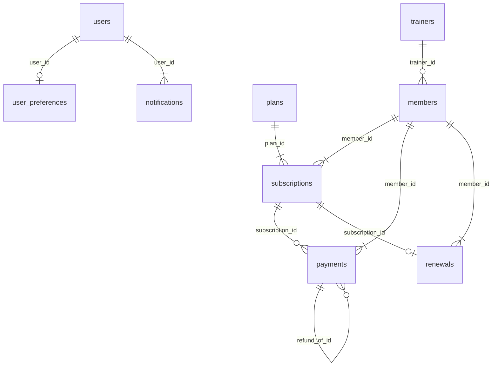

# IRONFLOW — Database Design Report

Gym membership management system. Backend: Python (Flask) · Database: SQLite (standard SQL, portable to MySQL/PostgreSQL) · Frontend: HTML/CSS/JavaScript.

## 1. Scope
IRONFLOW tracks gym members, membership plans, subscriptions (a member's period on a plan), trainers, manual payment records, renewals, notifications and an audit trail. It records payments entered by staff; it does not process money and stores no card, CVV or UPI PIN data.

## 2. Entity-relationship diagram


Crow's-foot notation: a bar is the "one" side, a crow's foot is the "many" side, a circle means optional. Mermaid version (paste into any Mermaid renderer):



## 3. Relationships
| Parent (1) | Child (N) | Foreign key | On delete | Participation |
|---|---|---|---|---|
| users | user_preferences | user_id | CASCADE | mandatory (1:1) |
| trainers | members | trainer_id | RESTRICT | optional (1:N) |
| members | subscriptions | member_id | RESTRICT | mandatory (1:N) |
| plans | subscriptions | plan_id | RESTRICT | mandatory (1:N) |
| members | payments | member_id | RESTRICT | mandatory (1:N) |
| subscriptions | payments | subscription_id | NO ACTION | optional (1:N) |
| members | renewals | member_id | RESTRICT | mandatory (1:N) |
| subscriptions | renewals | subscription_id | NO ACTION | mandatory (1:1) |
| users | notifications | user_id | CASCADE | mandatory (1:N) |
| payments | payments | refund_of_id | (logical, no FK) | each refund row points to its original payment |

## 4. Data dictionary
### users
| Column | Type | Constraints |
|---|---|---|
| id | TEXT | PRIMARY KEY |
| name | TEXT | NOT NULL |
| email | TEXT | NOT NULL, UNIQUE |
| password_hash | TEXT | NOT NULL |
| role | TEXT | NOT NULL, CHECK(role IN('ADMIN','STAFF')) |
| created_at | TEXT | DEFAULT (datetime('now')) |

### user_preferences
| Column | Type | Constraints |
|---|---|---|
| user_id | TEXT | PRIMARY KEY, FK → users(id) |
| theme | TEXT | DEFAULT 'system' |
| accent | TEXT | DEFAULT '#C7FF4A' |
| notify_expiry | INTEGER | DEFAULT 1 |
| notify_dues | INTEGER | DEFAULT 1 |

### trainers
| Column | Type | Constraints |
|---|---|---|
| id | TEXT | PRIMARY KEY |
| full_name | TEXT | NOT NULL |
| email | TEXT | NOT NULL, UNIQUE |
| phone | TEXT |  |
| specialization | TEXT | NOT NULL |
| experience_years | INTEGER | DEFAULT 0 |
| certifications | TEXT |  |
| is_active | INTEGER | DEFAULT 1 |
| notes | TEXT |  |
| created_at | TEXT | DEFAULT (datetime('now')) |
| updated_at | TEXT | DEFAULT (datetime('now')) |

### members
| Column | Type | Constraints |
|---|---|---|
| id | TEXT | PRIMARY KEY |
| code | TEXT | NOT NULL, UNIQUE |
| full_name | TEXT | NOT NULL |
| email | TEXT | NOT NULL, UNIQUE |
| phone | TEXT | NOT NULL, UNIQUE |
| dob | TEXT |  |
| gender | TEXT |  |
| join_date | TEXT | NOT NULL |
| emergency_contact | TEXT |  |
| notes | TEXT |  |
| is_active | INTEGER | DEFAULT 1 |
| is_demo | INTEGER | DEFAULT 0 |
| trainer_id | TEXT | FK → trainers(id) |
| created_at | TEXT | DEFAULT (datetime('now')) |
| updated_at | TEXT | DEFAULT (datetime('now')) |

### plans
| Column | Type | Constraints |
|---|---|---|
| id | TEXT | PRIMARY KEY |
| name | TEXT | NOT NULL, UNIQUE |
| duration_days | INTEGER | NOT NULL, CHECK(duration_days>0) |
| price | REAL | NOT NULL, CHECK(price>=0) |
| description | TEXT |  |
| benefits | TEXT | DEFAULT '[]' |
| is_active | INTEGER | DEFAULT 1 |
| created_at | TEXT | DEFAULT (datetime('now')) |
| updated_at | TEXT | DEFAULT (datetime('now')) |

### subscriptions
| Column | Type | Constraints |
|---|---|---|
| id | TEXT | PRIMARY KEY |
| member_id | TEXT | NOT NULL, FK → members(id) |
| plan_id | TEXT | NOT NULL, FK → plans(id) |
| plan_name | TEXT | NOT NULL |
| price_snapshot | REAL | NOT NULL |
| duration_days_snapshot | INTEGER | NOT NULL |
| starts_on | TEXT | NOT NULL |
| expires_on | TEXT | NOT NULL |
| status | TEXT | CHECK(status IN('ACTIVE','CANCELLED')), DEFAULT 'ACTIVE' |
| cancelled_at | TEXT |  |
| created_at | TEXT | DEFAULT (datetime('now')) |

### payments
| Column | Type | Constraints |
|---|---|---|
| id | TEXT | PRIMARY KEY |
| receipt_no | TEXT | NOT NULL, UNIQUE |
| idempotency_key | TEXT | UNIQUE |
| member_id | TEXT | NOT NULL, FK → members(id) |
| subscription_id | TEXT | FK → subscriptions(id) |
| amount | REAL | NOT NULL, CHECK(amount>0) |
| currency | TEXT | DEFAULT 'INR' |
| paid_on | TEXT | NOT NULL |
| method | TEXT | NOT NULL |
| status | TEXT | NOT NULL, CHECK(status IN('PAID','PENDING','FAILED','REFUNDED')), DEFAULT 'PAID' |
| description | TEXT |  |
| refund_of_id | TEXT |  |
| created_at | TEXT | DEFAULT (datetime('now')) |

### renewals
| Column | Type | Constraints |
|---|---|---|
| id | TEXT | PRIMARY KEY |
| idempotency_key | TEXT | NOT NULL, UNIQUE |
| member_id | TEXT | NOT NULL, FK → members(id) |
| subscription_id | TEXT | NOT NULL, UNIQUE, FK → subscriptions(id) |
| was_early | INTEGER | NOT NULL |
| created_at | TEXT | DEFAULT (datetime('now')) |

### notifications
| Column | Type | Constraints |
|---|---|---|
| id | TEXT | PRIMARY KEY |
| user_id | TEXT | NOT NULL, FK → users(id) |
| type | TEXT |  |
| message | TEXT |  |
| dedupe_key | TEXT | NOT NULL, UNIQUE |
| read_at | TEXT |  |
| created_at | TEXT | DEFAULT (datetime('now')) |

### audit_logs
| Column | Type | Constraints |
|---|---|---|
| id | TEXT | PRIMARY KEY |
| user_id | TEXT |  |
| action | TEXT |  |
| entity | TEXT |  |
| entity_id | TEXT |  |
| meta | TEXT |  |
| created_at | TEXT | DEFAULT (datetime('now')) |

## 5. Integrity rules
- **Entity integrity:** every table has a primary key (random 64-bit hex id).
- **Referential integrity:** foreign keys are enforced (`PRAGMA foreign_keys=ON` on every connection). Members, plans, subscriptions and payments use `ON DELETE RESTRICT`, so history is never orphaned: a member with payments cannot be deleted (deactivate instead), and a plan used by any subscription is archived, not deleted.
- **Domain integrity:** `CHECK` constraints limit roles, payment methods and statuses, amounts (> 0) and plan duration (> 0).
- **Uniqueness:** member email, phone and code; trainer email; plan name; payment receipt number; idempotency keys.

## 6. Normalization
- **1NF:** all columns are atomic, with one exception: `plans.benefits` stores a short JSON list for display only and is never queried relationally.
- **2NF/3NF:** every non-key attribute depends on the key, the whole key and nothing but the key. Members, plans, trainers, subscriptions and payments are separate tables linked by foreign keys.
- **Deliberate denormalization:** `subscriptions` copies `plan_name`, `price_snapshot` and `duration_days_snapshot` from the plan at purchase time, so a later price change never rewrites historical subscriptions or revenue. It is a historical snapshot, not redundancy to keep in sync.

## 7. Business rules
- **Revenue** = PAID − REFUNDED. **Dues** = PENDING. FAILED rows are ignored. A refund is a new REFUNDED row linked by `refund_of_id`; the original PAID row is never changed, and total refunds can never exceed the amount paid.
- **Renewal dates (India time, IST):** if the member's plan is still running, the new period starts the day after it ends (early renewal never loses days); otherwise it starts today. `expires_on` is inclusive: `starts_on + duration − 1`.
- **Status:** active (more than 7 days left), expiring (0–7 days), expired (past expiry or no plan), inactive (switched off).
- **Duplicates:** unique idempotency keys make double-clicks and retries safe for payments, renewals and refunds.
- **Audit:** renewals, payment status changes, refunds, trainer reassignments and account changes are written to `audit_logs`.

## 8. Transactions
Each API request runs in one database transaction: committed only if the response succeeds, rolled back on any error. A renewal therefore creates its subscription, payment, renewal-history and audit rows atomically, with no partial results.

## 9. Indexes
Indexes support the common searches: member name, subscriptions by (member, expiry), payments by member and by (date, status), audit logs by (entity, id). Unique constraints add indexes on the unique columns.

## 10. Sample SQL
All queries below were executed against a freshly created database (also in `docs/queries.sql`).

**Members and days left on their latest active plan**
```sql
SELECT m.code, m.full_name, s.plan_name, s.expires_on, CAST(julianday(s.expires_on) - julianday('now', '+5.5 hours') AS INTEGER) AS days_left FROM members m JOIN subscriptions s ON s.member_id = m.id AND s.status = 'ACTIVE' WHERE s.expires_on = (SELECT MAX(x.expires_on) FROM subscriptions x WHERE x.member_id = m.id AND x.status = 'ACTIVE') ORDER BY s.expires_on;
```

**Net revenue per month (paid minus refunded; pending and failed excluded)**
```sql
SELECT substr(paid_on, 1, 7) AS month, SUM(CASE status WHEN 'PAID' THEN amount WHEN 'REFUNDED' THEN -amount ELSE 0 END) AS net_revenue FROM payments GROUP BY month ORDER BY month;
```

**Outstanding dues per member**
```sql
SELECT m.code, m.full_name, SUM(p.amount) AS due FROM payments p JOIN members m ON m.id = p.member_id WHERE p.status = 'PENDING' GROUP BY m.id HAVING due > 0 ORDER BY due DESC;
```

**Trainer workload (includes trainers with no members)**
```sql
SELECT t.full_name, COUNT(m.id) AS members FROM trainers t LEFT JOIN members m ON m.trainer_id = t.id WHERE t.is_active = 1 GROUP BY t.id ORDER BY members DESC;
```

**Net revenue by plan**
```sql
SELECT s.plan_name, SUM(CASE p.status WHEN 'PAID' THEN p.amount ELSE -p.amount END) AS net FROM payments p JOIN subscriptions s ON s.id = p.subscription_id WHERE p.status IN ('PAID', 'REFUNDED') GROUP BY s.plan_name ORDER BY net DESC;
```

**Members with no live membership (NOT EXISTS)**
```sql
SELECT code, full_name FROM members m WHERE NOT EXISTS (SELECT 1 FROM subscriptions s WHERE s.member_id = m.id AND s.status = 'ACTIVE' AND s.expires_on >= date('now', '+5.5 hours'));
```

**Refundable balance per paid payment**
```sql
SELECT p.receipt_no, p.amount, COALESCE((SELECT SUM(r.amount) FROM payments r WHERE r.refund_of_id = p.id AND r.status = 'REFUNDED'), 0) AS refunded FROM payments p WHERE p.status = 'PAID';
```

## 11. Security design
- Passwords hashed with Werkzeug (salted); minimum 10 characters.
- HTTP-only, SameSite=Strict session cookie; custom-header CSRF check on every write; login rate limiting.
- All SQL uses bound parameters; input is validated server-side and escaped when rendered.
- Roles: ADMIN and STAFF. Role and account status are re-checked from the database on every request.

## 12. Limitations and future work
- SQLite allows one writer at a time, which suits a single gym; for many concurrent staff use PostgreSQL or MySQL (only the connection helper and a few date functions change).
- Notifications are in-app only. Email or SMS needs a provider adapter.
- Payments are manual records; a payment gateway would need its own reconciliation tables.